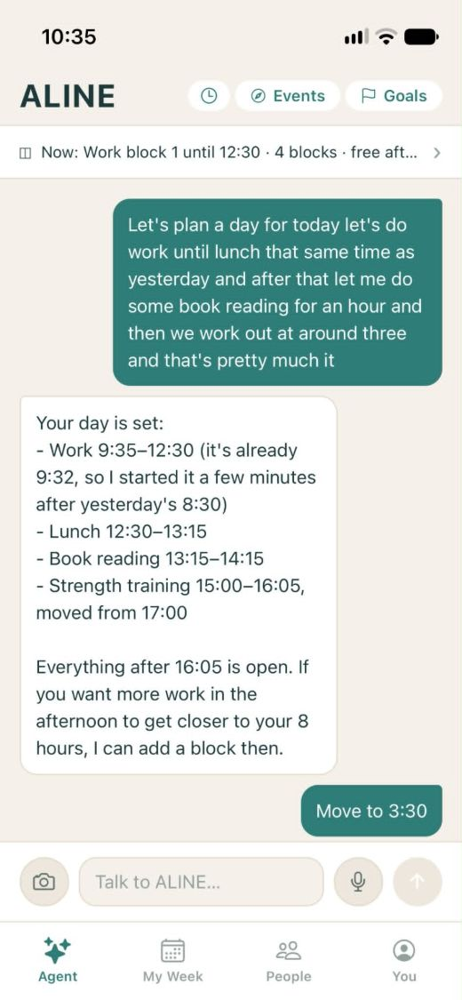
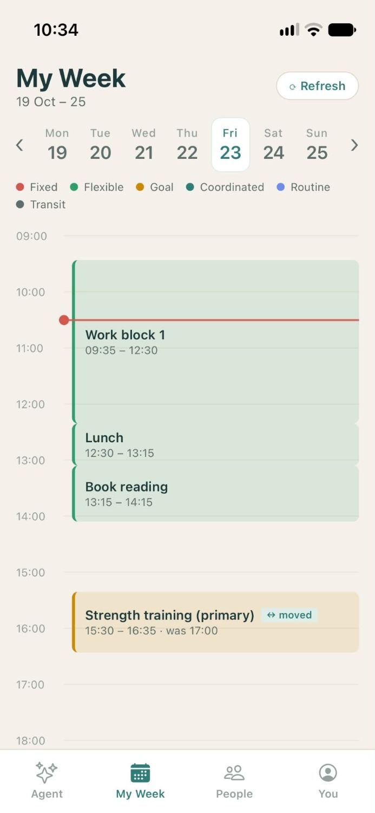
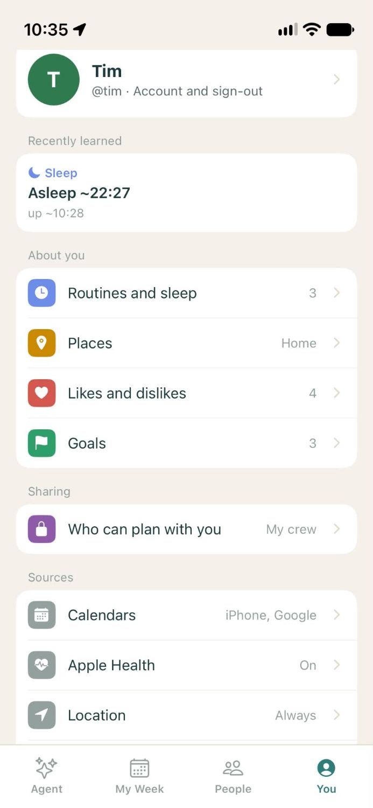

# ALINE

**A personal AI agent that runs your schedule and coordinates time with the people you care about.**

You talk to ALINE in a chat. It knows your calendar, your goals, where you usually are and when you sleep, and it plans your days around real life. It moves things when plans slip and finds time with friends without the group-chat back-and-forth. Each person has their own agent. Agents coordinate with each other within the sharing rules each person sets.

iOS app (Expo / React Native) · Supabase (Postgres, Edge Functions, pg_cron) · Claude as the agent.

<table>
  <tr>
    <td align="center"></td>
    <td align="center"></td>
    <td align="center"></td>
  </tr>
  <tr>
    <td align="center"><b>Plan by chat</b><br>One message becomes a full day; follow-ups like "move to 3:30" just work.</td>
    <td align="center"><b>My Week</b><br>The plan, colour-coded by type, with changes marked.</td>
    <td align="center"><b>You</b><br>What ALINE has learned (sleep, places, likes, goals) and who can plan with you.</td>
  </tr>
</table>

---

## What it does

| | |
|---|---|
| **Plan your day by chat** | "Fit 4 gym sessions and 8 h of work into this week": the agent proposes a set of changes, and you accept or reject them in one tap. |
| **Know what actually happened** | Location, motion and Health data become a timeline: *home → lunch 12:30–13:02 → home → strength training 16:47–18:03*. |
| **Learn you over time** | Places, routines, sleep times and likes are *earned* by repeated evidence, not guessed from a single data point. |
| **Coordinate with friends** | Mutual free slots, venue suggestions, invites, RSVPs. Each friend controls how much of their schedule an agent may see. |
| **Speak up rarely and usefully** | Proactive notifications have a daily cap, respect quiet hours learned from sleep, and are never sent twice. |

## Architecture

```
 iPhone app (Expo)                    Supabase                              External
┌────────────────────────┐        ┌──────────────────────────────────┐    ┌──────────────┐
│ Chat · Week · People · │  RLS   │ Postgres                          │    │ Claude       │
│ You (what ALINE knows) │◄──────►│  35 tables, row-level security   │    │ (agent)      │
│                        │        │  113 SQL functions + triggers    │    ├──────────────┤
│ Background signals:    │ pings  │  26 pg_cron jobs                 │    │ Google       │
│  • location (3 modes)  │───────►│                                  │◄──►│ Places,      │
│  • iOS visits + exit   │        │ Edge Functions (Deno)            │    │ Distance     │
│    fences (native)     │        │  agent-respond  ← the agent      │    │ Matrix,      │
│  • motion history      │        │  name-stays, resolve-places      │    │ Calendar     │
│  • HealthKit, calendar │        │  rebuild-summaries, health-probe │    ├──────────────┤
│  • push notifications  │◄───────│  google-calendar-*, weather      │    │ Expo push    │
└────────────────────────┘        └──────────────────────────────────┘    └──────────────┘
```

**The phone collects; the server thinks.** The app uploads raw signals: location pings, iOS visit events, motion segments, workouts and calendar events. Everything derived from them (stays, places, routines, sleep, summaries) is computed on the server, so every user gets the same logic and fixes ship without an app update.

### The agent (`supabase/functions/agent-respond`)

- Each message loads the user's context: goals, the week's calendar, today's actual timeline, places and routines, sleep, friends and their sharing level, pending changes, and learned preferences.
- Claude (Sonnet) runs with **~30 tools**, including `find_open_slots`, `find_mutual_slots`, `propose_change_set`, `propose_hangout`, `find_venue`, `get_travel_time`, `correct_visit`, `set_reminder` and `commit_goal_plan`.
- **Changes are proposals, not edits.** Schedule changes go out as a *change set* that the user accepts or rejects. The server rejects any change set that would overlap existing blocks or put the same goal twice on one day.
- Each reply also returns structured facts it learned. These are stored as *candidates* and only shown to the user once they're earned (see below).

### From pings to a day (`build_visits`, every 10 min)

1. Raw pings arrive from several sources: iOS visits (precise), place geofences, the movement stream and foreground opens.
2. Pings are clustered into **stays** and **travel**:
   - iOS visit events use a tighter radius than coarse background fixes.
   - iOS motion history decides walking, driving or "just a traffic light".
   - A stay where iOS never reported a departure ends at the next real break in motion.
3. Stays are matched to calendar events, Health workouts and named places. Names come from a stay-aware Google Places ranking: long stays favour destinations, short stops favour shops.
4. Places and routines are rebuilt hourly and only become "known" after **repeated visits on different days**.

### Earned knowledge

Nothing is shown as fact from a single observation:

| Level | Meaning | Used for |
|---|---|---|
| candidate | inferred once | a hint for the agent only |
| shown | stated explicitly ("I love football") or repeated on 2+ days | the *You* tab |
| verified | backed by behaviour (visits, workouts, attended plans) | matching people (planned) |

"Stated" is only accepted if the model quotes the user's own words and the quote is a first-person preference. A plan such as "schedule deep work 9–11" never becomes a like.

### Proactive notifications

All server-initiated pushes go through one guard (`try_proactive_push`). It enforces quiet hours, using learned sleep times once known, a cap of 3 per day, and a dedupe key so the same message is never sent twice. The push also lands in the chat, and the user answers there.

Current pushes:
- a quick daily question about something unclear
- the weekly goal check
- weather on outdoor plans
- plan-drift suggestions
- invite and RSVP reminders
- user-set reminders

### Reliability

- `health-probe` runs daily and makes real calls to Google Places, Distance Matrix and Claude, using the agent's exact configuration.
- `system_health_check` runs daily and checks cron failures, stale data collection and external API errors, then pushes an alert to the admin.

## Repository layout

```
app/                    expo-router screens
  (onboarding)/           handle, interests, permissions
  (app)/agent.tsx         chat with ALINE (voice dictation, inverted list)
  (app)/week.tsx          the week: plans + what actually happened
  (app)/groups.tsx        People: groups and friends
  (app)/profile/          You: an Apple-Settings-style mirror of what ALINE knows
src/lib/                signals (location, visits, motion, Health, calendar), data hooks
src/components/         shared UI
modules/day-signals/    native Swift: CLVisit monitoring, stop exit fences, motion history
modules/wifi-info/      native Swift: hashed Wi-Fi network (at-home signal)
supabase/functions/     Deno edge functions (agent, place naming, summaries, probes)
supabase/schema.sql     full database: tables, RLS policies, functions, triggers (pg_dump)
supabase/cron_jobs.sql  the 26 scheduled jobs
supabase/migrations/    database changes made after that snapshot (created with the first one)
```

## Running it

```bash
npm install
npm start                 # Expo dev server; iOS needs a dev build (native modules)
npx tsc --noEmit          # type-check
```

- **App env** (`.env`, gitignored): `EXPO_PUBLIC_SUPABASE_URL`, `EXPO_PUBLIC_SUPABASE_ANON_KEY`, `EXPO_PUBLIC_GOOGLE_CLIENT_ID`; optionally `EXPO_PUBLIC_SENTRY_DSN`.
- **Edge Function secrets** (Supabase dashboard): `ANTHROPIC_API_KEY`, `GOOGLE_OAUTH_CLIENT_ID`, `GOOGLE_OAUTH_CLIENT_SECRET`, `GOOGLE_MAPS_API_KEY`, `GOOGLE_PLACES_API_KEY`, `OPENWEATHER_API_KEY`, `CRON_SECRET`; optionally `ANTHROPIC_MODEL`.
- **Deploy a function:** `npx supabase functions deploy <name> --project-ref <ref>`. Add `--no-verify-jwt` for functions called by cron.
- **Restore the database:** run `supabase/schema.sql`, then `supabase/cron_jobs.sql`, on a project with `pg_cron` and `pg_net`. Then set the `app_config` values (cron secret and others), which are deliberately not in the repo.
- **iOS builds:** `eas build --platform ios --auto-submit` → TestFlight.

## Principles

1. **Suggest, never control.** The agent proposes; the person decides.
2. **Show why.** Every suggestion and question carries its reason.
3. **Actions over words.** What you do outweighs what you say; matching uses verified behaviour only.
4. **Build for every user.** No founder-specific data, time zone or language assumptions.
5. **Privacy by tier.** Strangers see nothing about location or timing; friends and inner circle see what they've been granted.
